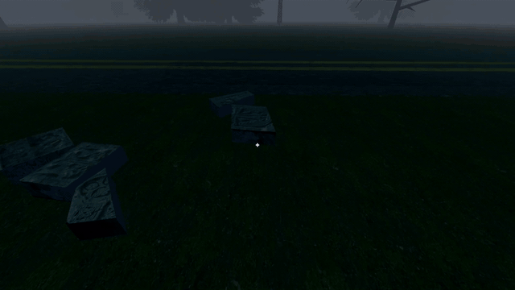

[Español](README.md)

# Legacy Times: Khachkar

A first-person puzzle game. You explore a museum of khachkars (Armenian cross-stones) that closed without warning, solve one puzzle per khachkar, and piece together what happened to the museum.



> **Finished** · v1.2.0 · Windows and Linux · Spanish only · [itch page](https://cgrassdev.itch.io/legacy-times-khachkar)

## How it plays

- The story opens on the front page of a newspaper, *The Legacy Times*, with a short piece about a forgotten museum. You arrive at night, in the fog, and the khachkar at the entrance is broken.
- Each room hides a khachkar behind a different puzzle: physical pieces you assemble by hand, photo panels, a terminal you type into, a piano and a world map.
- A camera with zoom lets you look for clues in the carved details, and an album keeps track of the khachkars you have found.
- Once every khachkar is back in its room, the final room opens and a recorded tape tells what happened.

| Action | Keyboard and mouse |
|---|---|
| Move | WASD or arrow keys |
| Look | Mouse |
| Sprint | Shift |
| Jump | Space |
| Interact / pick up | Left click |
| Open the album | E |
| Take out the camera | Q |
| Zoom (camera out) | Left click / right click |
| Pause and controls | Esc |

Played with keyboard and mouse. The controls are shown on screen at the start, and each hint disappears once you use it.

## Context

*Legacy Times: Khachkar* is my undergraduate thesis project for Computer Science Engineering (Ingeniería Civil en Computación) at Universidad de Chile, first semester of 2026, with Nelson Baloian as thesis advisor. The topic was the gamification of my advisor's virtual khachkar museum, which ended up becoming a video game for implicit learning: players get to know the khachkars while solving the puzzles, without the game teaching them as a lesson.

I worked alone on the game: design, programming, puzzles, story and level layout. The 3D models of the khachkars belong to Professor Baloian. The rest of the art and sound are free third-party assets (see [Credits](#credits-and-license)). Version 1.2.0 is the build used in the playtest evaluation, where players filled in a questionnaire after playing.

## How it's built

| | |
|---|---|
| Engine | Godot 4.6.1 |
| Language | GDScript |
| Renderer | GL Compatibility (OpenGL 3.3) |
| Physics | Jolt |
| Platforms | Windows and Linux |

- **Puzzles decoupled through signals.** Each puzzle emits `puzzle_solved` with its number. The main scene (`World/main_game.gd`) connects that signal to the khachkar room and to the album through groups. When the room has all six, it emits `all_solved` and the final door opens.
- **Built for integrated graphics.** It uses the compatibility renderer, baked lightmaps and occlusion culling. Tested on an Intel UHD 620.
- **Background loading.** The menu requests the museum scene with `ResourceLoader.load_threaded_request` and shows the progress. *Play* is enabled once loading finishes, so entering the game doesn't freeze the screen.
- **Physical interaction.** The pieces of the first puzzle are `RigidBody3D`s you pick up and drop. An `Area3D` detects when a piece reaches its spot and swaps it for the fixed version.
- The final tape reads its timed subtitles from a JSON file (`World/final_tape.json`).

## Opening and exporting

You need [Godot 4.6.1](https://godotengine.org/download/archive/4.6.1-stable/), the standard build (not .NET), with its export templates. A newer version converts the project when you open it.

The repo includes Godot's import cache (`.godot/`) and weighs about 5.6 GB. Clone it without history:

```
git clone --depth 1 https://github.com/clemgrass/MemoriaKhachkar.git
```

1. Open `titulacion-khachkar/project.godot` in Godot 4.6.1.
2. Run the game with F5. It starts at the menu (`MainMenu/mainMenu.tscn`).

To export without opening the editor (the *Windows Desktop* and *Linux* presets are already in `export_presets.cfg`, with the `.pck` embedded in the executable):

```
godot --headless --path titulacion-khachkar --export-release "Windows Desktop" build/LegacyTimesKhachkar.exe
godot --headless --path titulacion-khachkar --export-release "Linux" build/LegacyTimesKhachkar.x86_64
```

## Credits and license

- **Clemente Grass Briones**: design, programming, puzzles, story and levels.
- **Nelson Baloian**: thesis advisor. 3D models of the khachkars.

Third-party assets:

- PBR textures from [ambientCG](https://ambientcg.com) and [Poly Haven](https://polyhaven.com) (CC0).
- Piano notes: the *Do, re, mi, fa, so, la, ti, do* pack by [Jaz_the_MAN_2](https://freesound.org/people/Jaz_the_MAN_2/) on Freesound (CC0).
- Key and mouse icons: [Kenney](https://kenney.nl) and [Xelu's Free Controller & Key Prompts](https://thoseawesomeguys.com/prompts/) (CC0).
- Images and textures from [Pixabay](https://pixabay.com), [Unsplash](https://unsplash.com), [pxhere](https://pxhere.com) and [Texturelabs](https://texturelabs.org), under their respective licenses.
- [Libre Baskerville](https://fonts.google.com/specimen/Libre+Baskerville) font (SIL Open Font License 1.1).

**Code:** [MIT](LICENSE). MIT applies to the source code only; the 3D models of the khachkars are © Nelson Baloian and are not licensed for reuse. Third-party assets remain under their own licenses.
