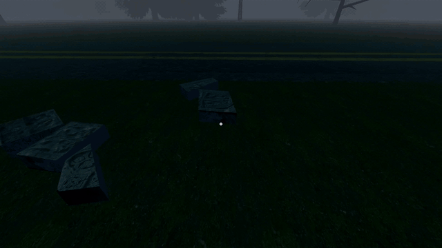

[English](README.en.md)

# Legacy Times: Khachkar

Juego de puzzles en primera persona. Recorres un museo de khachkars (cruces de piedra armenias) que cerró de golpe, resuelves un puzzle por cada khachkar y vas descubriendo qué pasó con el museo.



> **Terminado** · v1.3.0 · Windows y Linux · Historia en español, menús en inglés · [Página en itch](https://cgrassdev.itch.io/legacy-times-khachkar) 

## Cómo se juega

- La historia empieza en un diario, *The Legacy Times*, con una nota sobre un museo olvidado. Llegas de noche, con niebla, y el khachkar de la entrada está roto.
- Cada sala guarda un khachkar detrás de un puzzle distinto: piezas físicas que se arman a mano, paneles de fotos, una terminal donde se escribe, un piano y un mapa del mundo.
- Una cámara con zoom sirve para buscar pistas en los detalles tallados, y un álbum registra los khachkars que vas encontrando.
- Con todos los khachkars de vuelta en su sala se abre la sala final, donde una cinta grabada cuenta lo que pasó.
- Música original de Nicolás Marín.

| Acción | Teclado y mouse |
|---|---|
| Moverse | WASD o flechas |
| Mirar | Mouse |
| Correr | Shift |
| Saltar | Espacio |
| Interactuar / tomar objetos | Clic izquierdo |
| Abrir el álbum | E |
| Sacar la cámara | Q |
| Zoom (con la cámara) | Clic izquierdo / clic derecho |
| Pausa y controles | Esc |

Se juega con teclado y mouse. Los controles aparecen en pantalla al empezar y cada indicación desaparece cuando la usas.

## Contexto

*Legacy Times: Khachkar* es mi memoria de título de Ingeniería Civil en Computación en la Universidad de Chile (primer semestre de 2026), con el profesor guía Nelson Baloian. El tema fue la gamificación del museo virtual de khachkars del profesor, que terminó convertido en un videojuego para el aprendizaje implícito: el jugador va conociendo los khachkars mientras resuelve los puzzles, sin que el juego se los explique como una lección.

Hice el diseño, la programación, los puzzles, la historia y el armado de los niveles. Los modelos 3D de los khachkars son del profesor Baloian, y la música es de Nicolás Marín. El resto del arte y del sonido son assets libres de terceros (ver [Créditos](#créditos-y-licencia)). La versión 1.2.0 fue la que se usó en la evaluación con jugadores, que respondían un cuestionario después de jugar. La 1.3.0 es la versión final: agrega la música, los sonidos, los créditos completos y optimizaciones de rendimiento.

## Cómo está hecho

| | |
|---|---|
| Motor | Godot 4.6.1 |
| Lenguaje | GDScript |
| Render | GL Compatibility (OpenGL 3.3) |
| Física | Jolt |
| Plataformas | Windows y Linux |

- **Puzzles desacoplados con señales.** Cada puzzle emite `puzzle_solved` con su número. La escena principal (`World/main_game.gd`) conecta esa señal a la sala de khachkars y al álbum por medio de grupos. Cuando la sala tiene los seis, emite `all_solved` y se abre la puerta final.
- **Pensado para gráficos integrados.** Usa el renderer de compatibilidad, luces horneadas (lightmaps), occlusion culling, MultiMesh para los objetos repetidos y LOD de mallas. Se probó en una Intel UHD 620.
- **Carga en segundo plano.** El menú pide la escena del museo con `ResourceLoader.load_threaded_request` y muestra el progreso. *Play* se habilita cuando la carga termina, así que entrar al juego no congela la pantalla.
- **Interacción física.** Las piezas del primer puzzle son `RigidBody3D` que se toman y se sueltan. Un `Area3D` detecta cuándo una pieza llega a su lugar y la reemplaza por la versión fija.
- La cinta final lee sus subtítulos, con tiempos, de un JSON (`World/final_tape.json`).
- La música suena en loop con pausas al azar de 15 a 45 segundos y una leve variación de tono en cada vuelta (`World/main_game.gd`).

## Abrirlo y exportarlo

Necesitas [Godot 4.6.1](https://godotengine.org/download/archive/4.6.1-stable/), la versión estándar (no la .NET), con sus plantillas de exportación. Con una versión más nueva el proyecto se convierte al abrirlo.

El repo incluye la caché de importación de Godot (`.godot/`) y pesa unos 6 GB. Conviene clonarlo sin historial:

```
git clone --depth 1 https://github.com/clemgrass/MemoriaKhachkar.git
```

1. Abre `titulacion-khachkar/project.godot` en Godot 4.6.1.
2. Corre el juego con F5. Parte en el menú (`MainMenu/mainMenu.tscn`).

Para exportar sin abrir el editor (los presets *Windows Desktop* y *Linux* ya están en `export_presets.cfg`, con el `.pck` dentro del ejecutable):

```
godot --headless --path titulacion-khachkar --export-release "Windows Desktop" build/LegacyTimesKhachkar.exe
godot --headless --path titulacion-khachkar --export-release "Linux" build/LegacyTimesKhachkar.x86_64
```

## Créditos y licencia

- **Clemente Grass Briones**: diseño, programación, puzzles, historia y niveles.
- **Nelson Baloian**: profesor guía. Modelos 3D de los khachkars.
- **Nicolás Marín**: música original.
- **Mateo Grass** y **Martín Vergara**: testers.
- Gracias a los 29 jugadores que respondieron el cuestionario de la memoria. Sus nombres están en los créditos del juego.

Assets de terceros:

- Texturas PBR de [ambientCG](https://ambientcg.com) y [Poly Haven](https://polyhaven.com) (CC0).
- Notas de piano: pack *Do, re, mi, fa, so, la, ti, do* de [Jaz_the_MAN_2](https://freesound.org/people/Jaz_the_MAN_2/) en Freesound (CC0).
- Íconos de teclas y mouse: [Kenney](https://kenney.nl) y [Xelu's Free Controller & Key Prompts](https://thoseawesomeguys.com/prompts/) (CC0).
- Imágenes y texturas de [Pixabay](https://pixabay.com), [Unsplash](https://unsplash.com), [pxhere](https://pxhere.com) y [Texturelabs](https://texturelabs.org), bajo sus licencias.
- Sonido de botón: *Button UI sound effect* de emilianodleon en [Pixabay](https://pixabay.com) (Pixabay Content License).
- Fuente [Libre Baskerville](https://fonts.google.com/specimen/Libre+Baskerville) (SIL Open Font License 1.1).

**Código:** [MIT](LICENSE). La licencia MIT cubre solo el código fuente. Los modelos 3D de los khachkars son © Nelson Baloian y la música es © Nicolás Marín; ninguno de los dos se licencia para reutilizarlos. Los assets de terceros siguen bajo sus propias licencias.
